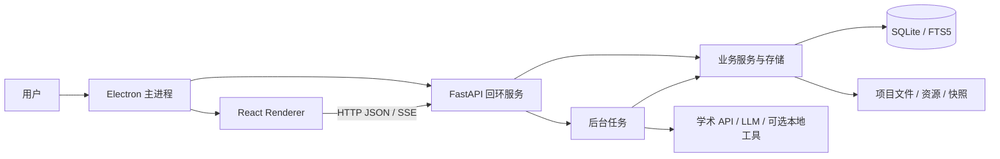

# 架构

## 进程与通信

| 层 | 入口 | 职责 |
|---|---|---|
| 桌面主进程 | `apps/desktop/electron/main.cjs` | 工作台选择、窗口、受限 IPC、后端子进程生命周期 |
| Renderer | `apps/desktop/src/main.tsx` | React、Zustand、CodeMirror、研究图谱及 HTTP/SSE 客户端 |
| 后端 | `backend/papercreator/__main__.py`、`api/app.py` | 配置、领域服务、持久化及异步任务 API |
| 后台任务 | `backend/papercreator/core/jobs.py` | 检索、分析、Agent、导出和目录导入等长任务 |

开发时 Renderer 使用 Vite `5173`，后端默认使用 `127.0.0.1:8765`。安装版从 ASAR 加载前端，并启动随包提供的后端可执行文件。后端没有通用用户认证，部署边界是本机回环地址。

## 后端模块

路径均相对于 `backend/papercreator/`。

| 模块 | 职责 |
|---|---|
| `api/routes/` | Pydantic 校验、接口、错误映射和任务提交 |
| `core/` | 配置、路径、SQLite、共享模型、事件和任务设施 |
| `store/` | 文献、项目、资源、提示词、助手消息及运行记录的持久化 |
| `retrieval/` | 学术来源适配、查询展开、去重、排名和缓存 |
| `analysis/` | 嵌入、降维、聚类、增量定位和启发式缺口候选 |
| `llm/`、`agents/` | 模型协议、编排、预算、取消、快照及运行结果 |
| `importers/`、`writing/` | 文本提取、双语手稿、翻译和排版模板 |
| `convert/`、`vcs/` | 文档导出、本地 Git 和显式远程操作 |

领域逻辑放在对应模块，路由层只负责接口编排。外部进程需要超时、非交互执行和诊断脱敏；任务要支持协作取消。

## 存储与同步

用户选择普通文件夹作为工作台，数据位于其 `.papercreator/` 中。`projects/` 保存论文项目，`library/` 保存分类输入资料；配置、数据库、日志、缓存、模型和用户 Skill 由 `core/paths.py` 统一定位。

| 数据 | 权威来源与恢复边界 |
|---|---|
| 文献、任务、分析、助手消息、Agent 运行和评审 | SQLite；运行记录可能包含提示词、用户文本和冻结手稿 |
| 手稿 | UI 编辑写 SQLite 后 flush 到 `manuscript/*.md`；外部编辑或 Git checkout 后从磁盘 reindex |
| 项目版本 | 项目 Git 和 SQLite snapshots |
| 托管资源 | `library/` 内文件；数据库保存相对路径、摘要和关联 |
| Skill | `SKILL.md` 文件；数据库缓存元数据 |
| 配置与密钥 | `config/settings.json`、`config/secrets.json` 及环境覆盖层 |

手稿同步依据双方指纹检测冲突。不能通过无条件 flush/reindex 覆盖另一侧修改；冲突处理和恢复见[运维指南](operations.md)。目录导入先检查文件清单、空间、链接及源文件变化，再同盘 staging、原子重命名，最后登记数据库。

## 扩展点

- 检索 Provider：继承 `retrieval.base.Provider`，在 `retrieval/providers/__init__.py` 注册。
- LLM：实现 `llm.base.LLMBackend`，加入 `llm/backends.py` 的 `BACKENDS`。
- Agent：继承 `agents.base.Agent`，在编排层注册角色和输入输出。
- Skill：使用声明式 `SKILL.md`，不执行任意 Python 插件。
- 分析算法：在现有策略中扩展，明确向量空间、随机种子、回退及增量 transform 兼容性。

具体接口见 [API 参考](api_reference.md)，配置与本地数据边界见[配置指南](configuration.md)。
